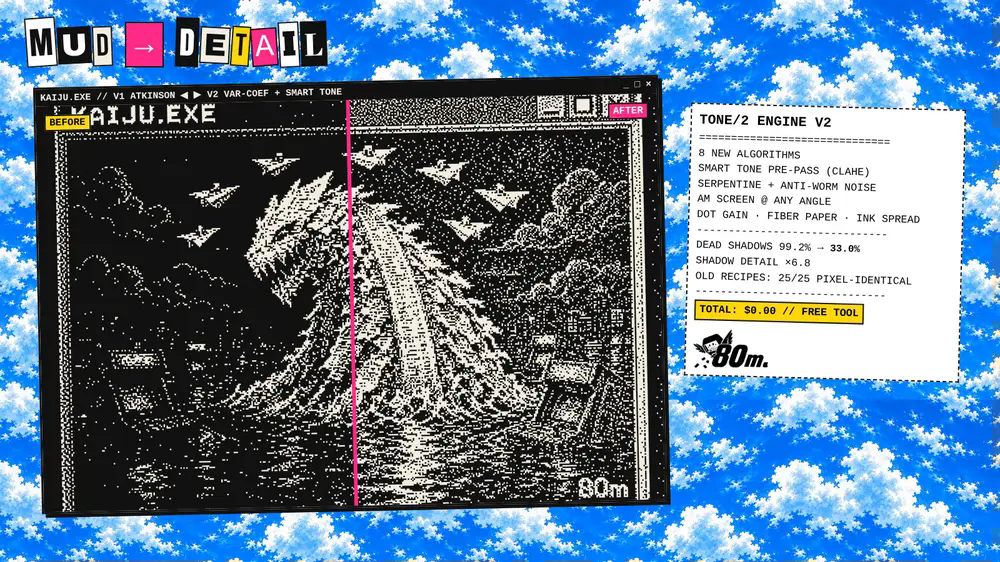
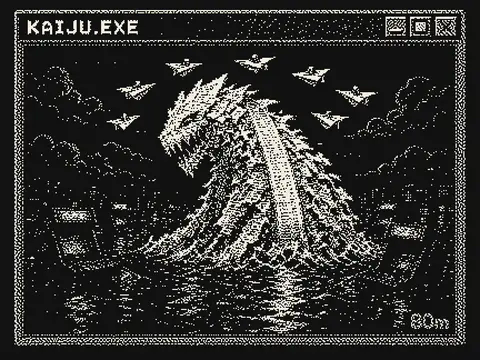
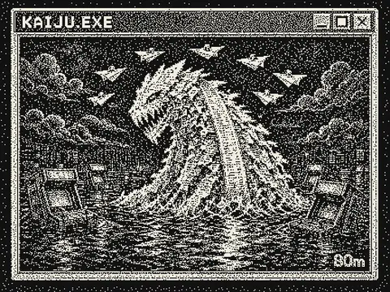
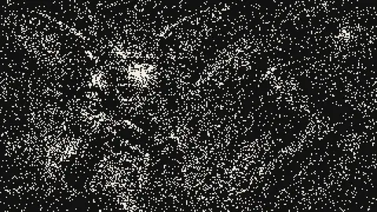
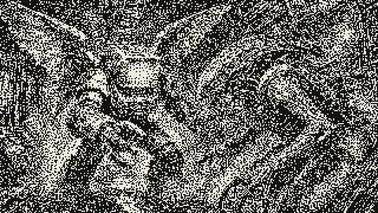
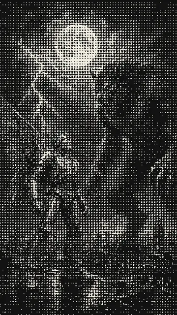
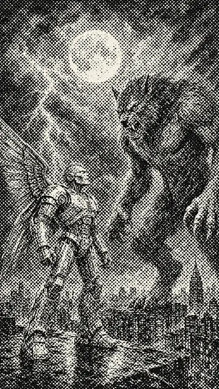
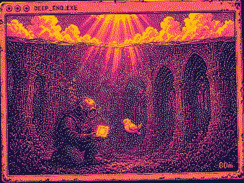
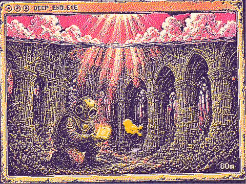
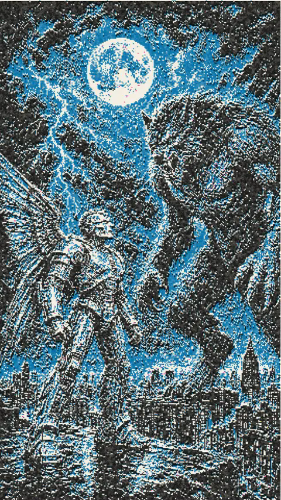

# tone/2 — Your shadows deserved better.

**A free, open-source halftone + dither studio that runs in your browser.**
It has 20 dither algorithms, real multi-ink riso, and a Smart Tone pass that pulls detail out of dark art instead of burying it. There's no watermark, no account and no export cap.

Take it, fork it, ship it. **MIT licensed.** Made by [80m](https://80m.guru) for every visual we post.



```
DEAD SHADOWS (DARK ART, 1-BIT) .. 99.2% → 33%
SHADOW DETAIL ................... ×6.8
DITHER ALGORITHMS ............... 20
OLD RECIPES, SAME PIXELS ........ 25/25
WATERMARKS ...................... 0
PRICE ........................... $0.00
```
<sub>Measured on our own renders. "Dead shadows" means 8×8 blocks of flat ink in the darkest 30% of the source.</sub>

## Run it
**Web app (all modes):** open `index.html` in a browser, drop an image in, export a PNG or SVG. That's the whole install.

```bash
git clone https://github.com/guapdad4000/tone2.git
cd tone2 && open index.html        # or xdg-open / start
```

**CLI (vector CMYK halftone only):**
```bash
python3 -m venv venv && venv/bin/pip install -r requirements.txt
venv/bin/python tone2.py in.jpg -o out.png --preset comic_70s
```
The CLI doesn't render the dither, multi-ink or RIP modes; use the web app for those. Renders are seeded, so the same input and settings give the same pixels.

## Before / after
| Look | Before | After |
|---|---|---|
| **Dark art, 1-bit:** Atkinson → variable-coefficient + Smart Tone |  |  |
| **CRT grain:** hash noise → true void-and-cluster blue noise |  |  |
| **Print screen:** clustered 4×4 → AM screen at 45° |  |  |
| **Colour:** tritone bands → 3-ink OKLab multi-ink |  |  |



## What's in the box
- **Smart Tone:** auto levels, local contrast (CLAHE), shadow lift, clarity, gated edge sharpen and an optional "keep average lightness", all before the first dot lands. One AUTO button.
- **20 dither algorithms:**
  - Floyd-Steinberg, Atkinson, Jarvis-Judice-Ninke, Stucki, Burkes, Sierra, Two-Row Sierra, Sierra Lite
  - **variable-coefficient** (Ostromoukhov-style) and **Riemersma** Hilbert-curve
  - **true blue noise** (void-and-cluster, generated in-browser) and hash blue noise
  - Bayer 2/4/8/**16**, clustered-dot 4×4/**8×8**
  - a tone-calibrated **AM screen** at any angle and cell size
  - hard threshold
  - plus serpentine scan and anti-worm threshold noise
- **Multi-ink riso / screenprint:**
  - joint dither to an N-ink palette (ink picked in OKLab, error spread in linear light), with ordered and blue-noise variants
  - **per-ink AM screen angles**
  - misregistration, per-ink drum grain and overprint
  - 4 palettes: 80m Sky Riso, ATM Receipt, Kaiju Night, Pink Gold Vortex, or paste your own hex codes
- **Halftone and print:**
  - PostScript-style RIP spot shapes, vector halftone with SVG export, FM stipple, sine-wave modulation
  - CMYK with GCR and per-plate angles, film-positive plate export
  - dot gain (simulate or compensate), fibre paper, ink spread, ink melt, comic keyline
- **Recipes are JSON.** Every look saves and loads as a `.tone2.json`, so you can share it, diff it or hand it to your agent. Old recipes are pinned: after engine V2 landed, the 25 legacy recipes we tested (built-ins plus our pack) re-rendered **pixel-identical**.

`recipes/` has the 12 built-in looks plus 6 V2 examples. Load them with the app's recipe import.

## Clone it. Fork it. Seriously.
It's one HTML file plus a small Python CLI. There's no build step, no framework and no account. Rip the engine out (start at `ditherV2`, `applyToneV2` and `renderDitherMultiInk`), drop it into your app, and sell what you make. That's what MIT is for. Credit is appreciated, not required.

PRs are welcome, especially for anything in the next list.

## Honest limits
- Stills only: no video or batch export yet.
- The app loads Tailwind from a CDN for **styling**. Rendering is plain canvas JS and runs locally; your images never leave the browser.
- The CLI covers vector halftone only.
- The variable-coefficient table is an approximation of the published one.
- The per-ink AM split is a soft OKLab assignment, not a full colour separation.

## Want our tuned looks?
The **80m tone/2 Preset Pack** (18 recipes, before/after cards and a guide, $19) is coming soon at **[80m.guru/tone2](https://80m.guru/tone2)**. The app stays free forever.

Follow **[@80mguru](https://x.com/80mguru)** on X.

---
MIT © 2026 80m
